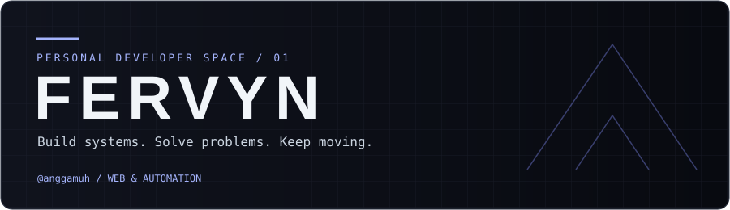

 

## 01 / About

I build practical web applications, business tools and automation. I enjoy turning repetitive workflows into simple, useful systems.

- **Focus:** backend development, dashboards and automation
- **Exploring:** cleaner architecture, reliable integrations and better user experiences
- **Philosophy:** build with purpose, iterate with curiosity

## 02 / Toolkit

## 03 / What I build

| Area | Focus |
| :--- | :--- |
| **Web applications** | Personal dashboards and management tools |
| **Business automation** | Reporting, reconciliation and operational workflows |
| **Discord ecosystem** | Music, community tools and bot dashboards |

Explore my available public repositories [here](https://github.com/anggamuh?tab=repositories).

## 04 / Activity

 

---

**F E R V Y N**

Code. Build. Explore. Repeat.

